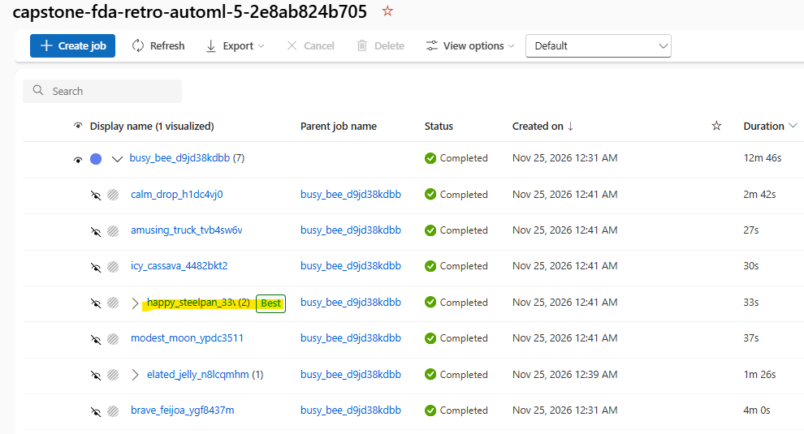
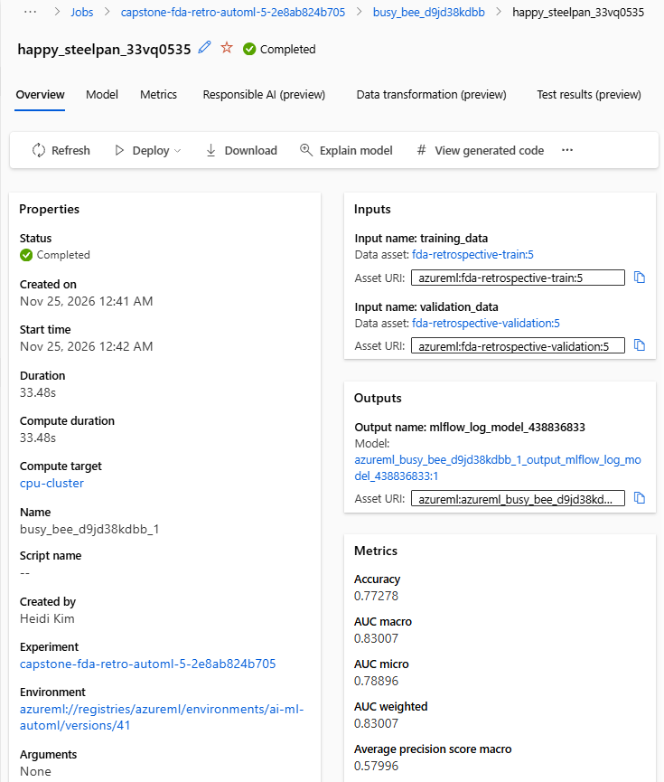
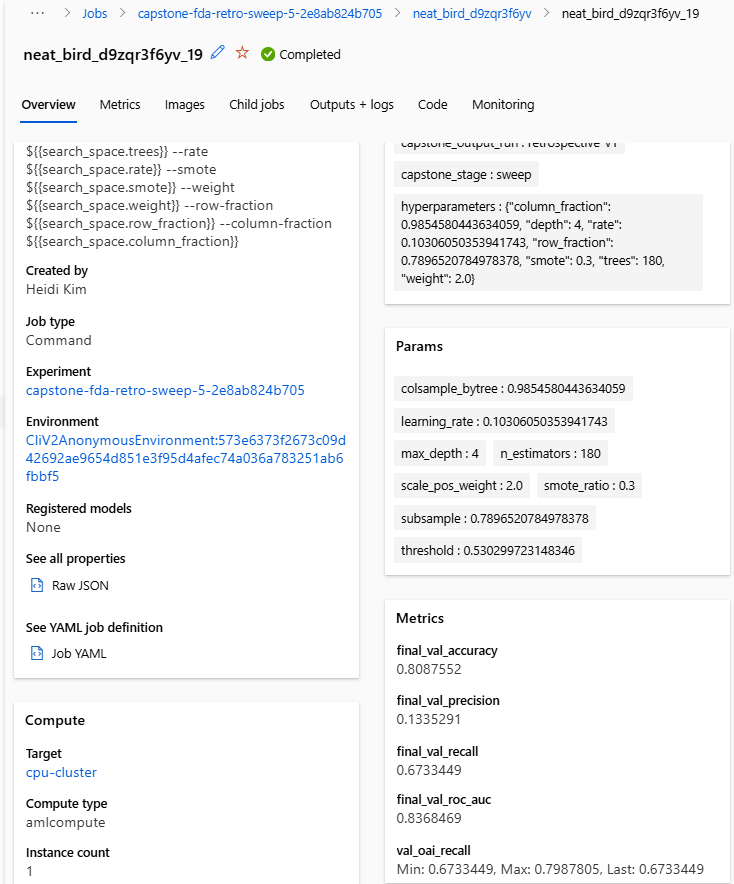

# Capstone Project: Udacity MS Azure ML Engineer - FDA Inspection Risk Classification

This Udacity Capstone classifies recorded FDA inspections for Official Action Indicated (OAI). Azure AutoML and a custom XGBoost sweep train on the same FDA cohort and FEI-disjoint train and validation splits. Both winners are scored on the same holdout. This comparison is **retrospective** because it uses the recorded inspection’s own posted citation count.

## Dataset and Classification Task

The external dataset comes from the FDA Inspections Data Dashboard. It contains public inspection records for regulated facilities and their final inspection classifications. FDA assigns **No Action Indicated (NAI)**, **Voluntary Action Indicated (VAI)**, or **Official Action Indicated (OAI)**. The Capstone treats OAI as the positive class (`1`) and groups NAI and VAI as the negative class (`0`). This is a binary classification task with an imbalanced positive class. [FDA Inspections Data Dashboard](https://datadashboard.fda.gov/oii/cd/inspections.htm) · [FDA Inspections classification reference](https://www.fda.gov/media/181859/download?attachment)

The project uses two local FDA workbook snapshots. `Data_FDA_Inspections_FY_09_26.xlsx` supplies the inspection records, classifications, and posted-citation indicator. `Data_FDA_Citations_FY_09_26.xlsx` is audited as a separate source. Citation text is excluded from the modeling feature set. The model predicts the recorded inspection outcome using inspection and facility context, prior inspection history, and the inspection’s own posted-citation count. This is a retrospective task.

This Capstone extends the author’s *USA FDA NonCompliance Risk Analysis* deck (`USA_FDA_NonCompliance_Risk_Analysis_YooT_v2.pdf`). Its **Model Performance** slide reports **0.78 OAI recall, 0.12 precision, and 0.83 ROC AUC** for XGBoost. These are the historical benchmark targets.

### How the Data Reaches Azure ML

Place the two workbooks in `data/raw/`. Sections 02–03 check their fingerprints and prepare a 70% sample of the aggregated inspection records. The notebook separates facilities by FDA Establishment Identifier (FEI) across train, validation, and test. It fits the one-hot encoding and selects the shared numeric inputs using training and validation, then holds out the test rows for comparison. Section 05 uploads each prepared Parquet and MLTable folder and registers it in Azure ML Studio. Section 06 reads the registered assets back to verify them.

The comparison uses `fda-retrospective-train:5`, `fda-retrospective-validation:5`, and `fda-retrospective-test:5`. The holdout contains **46,498 inspections**, including **1,917 OAI** outcomes.

## Workflow

```text
FDA workbooks → original 70% cohort → shared FEI splits and compact numeric features
                                              ├─ AutoML → registered winner
                                              └─ smoke → XGBoost sweep → registered winner
Both winners + original benchmark → holdout comparison → accuracy winner → HTTP test
```

`src/prepare_data.py` owns the data and feature recipes. `src/train.py` owns feature-subset ranking, the custom trial, and original benchmark metrics. `pipeline/evaluation.yml` defines the custom command used by the notebook's smoke and sweep. `src/model_registry.py` and `deployment/consume.py` handle lineage and authenticated scoring.

## Azure Run Order

Place both original FDA Excel workbooks in `data/raw/`. Use the same Azure ML SDK v2 notebook kernel. Set `DATA_VERSION` and workspace details in Section 00. On the first run with this recipe, use data version 5 and new version 5 registered model names as configured by default.

| Sections | First run | Reruns |
| --- | --- | --- |
| 00–07 | Enable `PREPARE_DATA` in 03 and `REGISTER_DATA` in 05 once. | Turn both off after the prepared files and registered assets exist. |
| 08–09 | Enable `SUBMIT_AUTO` once. After completion, enable `REGISTER_AUTO_MODEL` once. | Recover the job and registered model with both flags off. |
| 10–13 | Run 10. Submit smoke in 11. Submit sweep in 12 after smoke completes. Register the winner in 13 after completion. | Use the saved job IDs and model version. |
| 14–15 | Score both on the same holdout. The first run also computes and caches historical reference metrics locally. | Review the comparison and recorded deployment choice. |
| 16–21 | Verify the chosen version and inference environment. Create or update the endpoint deployment only as needed, route traffic if needed, and test HTTP scoring. Capture evidence before cleanup. | Keep the action switches off when the expected deployment is already active. |

Turn every action switch back off after it succeeds. Run status or registration cells after their prerequisite jobs complete. AutoML can run while the smoke and sweep branch progresses. Increment the asset and model versions when a new recipe would conflict with existing registered versions. The companion notebooks [automl.ipynb](automl.ipynb) and [hyperparameter_tuning.ipynb](hyperparameter_tuning.ipynb) reuse the master notebook cells. The original starter file contents were unavailable in this checkout.

## Model Settings and Selection

**AutoML.** Azure ML compares LightGBM and logistic regression on the same train and validation assets as the sweep. The primary metric is **normalized macro recall**, which gives both classes equal weight in the underlying macro recall calculation. This matters because OAI is uncommon. The job allows up to four trials, one at a time, with a 90-minute overall limit and 25 minutes per trial. Voting and stacked ensembles are disabled. The recorded winner is child run `busy_bee_d9jd38kdbb_1` under parent `busy_bee_d9jd38kdbb`, registered as `capstone-fda-retrospective-automl:5`. It achieved **0.5146 normalized macro recall** and **77.28% accuracy** on validation. See the winning-trial evidence for the AutoML configuration exposed by Studio.

**Custom XGBoost sweep.** A smoke run checks training and model export before the SDK v2 sweep. The sweep uses random sampling and a Bandit early termination policy, logs validation recall during training, and allows up to 25 trials with one concurrent trial. Each trial chooses a score threshold on validation, using OAI recall above 12% precision when feasible, and saves that threshold with the model.

| Sweep parameter | Search values |
| --- | --- |
| Maximum tree depth | 2, 4, 6, 9, 13 |
| Number of trees | 50, 100, 180 |
| Learning rate | 0.025–0.20 |
| SMOTE minority-to-majority ratio | 0, 0.1, 0.2, 0.3, 0.5, 0.7, 1.0 |
| Positive-class weight | 1, 2, 4, 8, 16 |
| Row and column sampling fractions | 0.70–1.00 each |

The sweep winner is `neat_bird_d9zqr3f6yv_0`, under parent `neat_bird_d9zqr3f6yv`. It uses **depth 2 and 180 trees**, achieved **70.64% OAI recall and 13.50% precision** on validation, and was registered as `capstone-fda-retrospective-xgb:5`. Section 13 and the winning-trial screenshot show the other tuned values.

### Azure Holdout Results

| Model | Accuracy | OAI recall | OAI precision | OAI F1 | ROC AUC | Average precision | False positives | Missed OAI |
| --- | ---: | ---: | ---: | ---: | ---: | ---: | ---: | ---: |
| Original XGBoost recipe | 73.52% | 77.31% | 11.09% | 0.1940 | 0.8127 | 0.1571 | 11,876 | 435 |
| Original recipe with validation-tuned threshold | 82.26% | 57.54% | 12.92% | 0.2110 | 0.8127 | 0.1571 | 7,433 | 814 |
| Azure AutoML | 77.22% | 71.52% | 12.01% | 0.2057 | 0.8154 | 0.1494 | 10,044 | 546 |
| Azure XGBoost sweep | **80.18%** | 67.40% | **13.07%** | **0.2190** | **0.8260** | **0.1905** | **8,592** | 625 |

Section 15 selects the XGBoost sweep winner because it had higher holdout accuracy among the two Azure branch winners, as called for by the Udacity checklist. AutoML caught 79 more OAI cases and generated 1,452 more false positives. Neither Azure candidate exceeded all three deck targets on this holdout. The original-recipe rows provide benchmarks for interpreting the two Azure results.

## Managed Endpoint and Sample Request

The deployment candidate is `capstone-fda-retrospective-xgb:7` in the `blue` deployment under `fda-capstone-yoots-01`. Version 5 is the evaluated model. Version 7 carries the same fitted model from `neat_bird_d9zqr3f6yv_0` with repaired inference dependencies. Verify the model version and active traffic in Azure before running the demo.

1. Run Section 16 to verify the scoring signature. For the repaired deployment, export `requirements.txt` from the registered version 7 MLflow artifact to `environment/inference-requirements.txt`. The dependency file should describe the version serving the endpoint. The training environment is documented in [conda_sweep.yaml](environment/conda_sweep.yaml).
2. After the deployment is healthy, run Section 19 to generate `deployment/sample-request.json` and `deployment/request-schema.json` from two rows of the registered training data. The request uses `input_data` with ordered feature columns, an index, and numeric rows. Use the generated request for version 7.
3. Run Section 20, or from the project root in an authenticated Azure ML environment run the following.

```bash
python deployment/consume.py \
  --subscription YOUR_SUBSCRIPTION_ID \
  --resource-group YOUR_RESOURCE_GROUP \
  --workspace YOUR_WORKSPACE_NAME \
  --endpoint fda-capstone-yoots-01
```

The client validates the sample against the request schema, gets the endpoint key at runtime, and sends an authenticated HTTP request. A successful test returns HTTP 200 and one binary label per row. The active deployment and response are shown in the evidence section.

### SDK v2 Rubric Evidence

The notebook uses an SDK v2 AutoML job and an SDK v2 sweep for the rubric’s AutoML and HyperDrive requirements. The Azure ML Studio trial views provide the progress evidence corresponding to SDK v1 `RunDetails`. Sections 09 and 13 show the winning trials and registration, Sections 14–15 compare the winners and select the deployment model, and Sections 16–20 show the inference environment, deployment, and sample request.

## Earlier Local Benchmark Results

Local reproduction on the supplied workbook produced 186,547 sampled rows and 46,197 test rows, including 1,950 OAI cases. The original XGBoost recipe chose SMOTE 0.7 and the same ten features shown in the local importance export.

| Local parity model | Accuracy | ROC AUC | OAI precision | OAI recall |
| --- | ---: | ---: | ---: | ---: |
| XGBoost | 0.7415 | 0.8276 | 0.1162 | 0.7754 |
| Random Forest | 0.7445 | 0.8054 | 0.1145 | 0.7508 |
| Logistic Regression | 0.8450 | 0.8228 | 0.1494 | 0.5697 |
| Decision Tree | 0.7454 | 0.7966 | 0.1144 | 0.7462 |

The local Logistic Regression row closely matches the deck's Decision Tree row, and the local Decision Tree row closely matches the deck's Logistic Regression row. The benchmark reports both sets of values under their original labels so the discrepancy is visible.

A local run of the 24-trial search produced the following results on the same 46,498-row holdout with 1,917 OAI cases.

| Model | OAI recall | OAI precision | False positives | ROC AUC |
| --- | ---: | ---: | ---: | ---: |
| Original XGBoost recipe | 78.09% | 11.15% | 11,927 | 0.8120 |
| Original recipe with validation-tuned threshold | 56.08% | 13.01% | 7,186 | 0.8120 |
| Enhanced XGBoost | 83.67% | 11.93% | 11,838 | 0.8596 |

Validation selected the full expanded feature set, a positive class weight of 16, no SMOTE, and a threshold of 0.3754. The enhanced model caught 107 additional OAI cases and generated 89 fewer false positives than the original recipe on this holdout. It exceeded 78% recall and improved on the original recipe's precision. Its holdout precision fell slightly short of the separate 12% deck target. The fixed holdout was not used to change the threshold after scoring.

Both comparisons are retrospective because they include the inspection's own `sum_posted_citations` as in the original model. The separate citation workbook is audited. Its citation-text merge remains excluded, as in the deck implementation. These are prior local results. The new Azure comparison uses a shared compact feature subset for AutoML and XGBoost, so its metrics must be measured again.

## Azure ML Screenshots

Keep the `screenshots/` folder beside this README in Azure ML and in GitHub. Save all eight PNGs directly in that folder. The filenames follow Project 2’s `pN_step_NN_description.png` pattern using the Capstone part and section numbers. Include only screenshots from the runs and model version reported in the final notebook.

Before publishing, run `git ls-files screenshots/` and check that each image path below matches a tracked filename exactly, including capitalization.

### Data and Shared Splits


*Capture Azure ML Studio → Data → Data assets. Filter for `fda-retrospective-` and show the train, validation, and test asset names and their version.*

### AutoML Training and Registered Winner



*Capture Azure ML Studio → Jobs → AutoML parent → Models. Include the parent name, completed status where visible, trial list, and normalized macro recall values.*



*Capture the Section 09 output showing the winning child ID and registered model name and version. Keep trial metrics and model parameters visible where available.*

### XGBoost Sweep and Registered Winner


*Capture Azure ML Studio → Jobs → sweep parent → Child jobs. Show completed trials and the validation recall metric. Use the parent Metrics or Charts view if it shows progress more clearly.*



*Capture Section 13 with the selected child ID, tuned parameters, validation metrics, and registered model name and version.*

### Holdout Results and Model Selection


*Capture the Section 14 holdout table with both candidates and the accuracy, recall, precision, and ROC AUC columns. Include Section 15’s selected winner if it fits at a readable size.*

### Active Deployment and Live Inference


*Capture Azure ML Studio → Endpoints → dedicated endpoint → Details. Show endpoint and blue deployment status as Succeeded, blue receiving 100% traffic, and the model version if visible.*


*Capture Section 20 after live inference with the sample input and successful HTTP status and predictions visible. Keep endpoint keys and authorization headers out of the capture.*

## Screencast

**YouTube screencast:** [Watch the FDA Capstone demo](https://youtu.be/qaUYIMuKTUY)

Record a 1–5 minute demo at 1080p or higher in 16:9. Show the versioned dataset, both training branches, the holdout comparison, the active deployment, and a live request and response. Verify the hosted link opens with viewer permissions before submitting.

## Submission and GitHub

Include the inference environment details, sample request, source scripts, both companion notebooks, master notebook, and the `screenshots/` tree in the submission ZIP. Leave out trained model binaries and the video file. Publish the reviewed files from the Capstone GitHub clone. Verify the README image paths and YouTube link on GitHub before submitting.

## Future Improvements

Measure prospective performance with inputs available before an inspection and evaluate on a fresh temporal holdout. Calibrate thresholds using review capacity and the cost of missed OAI cases.
