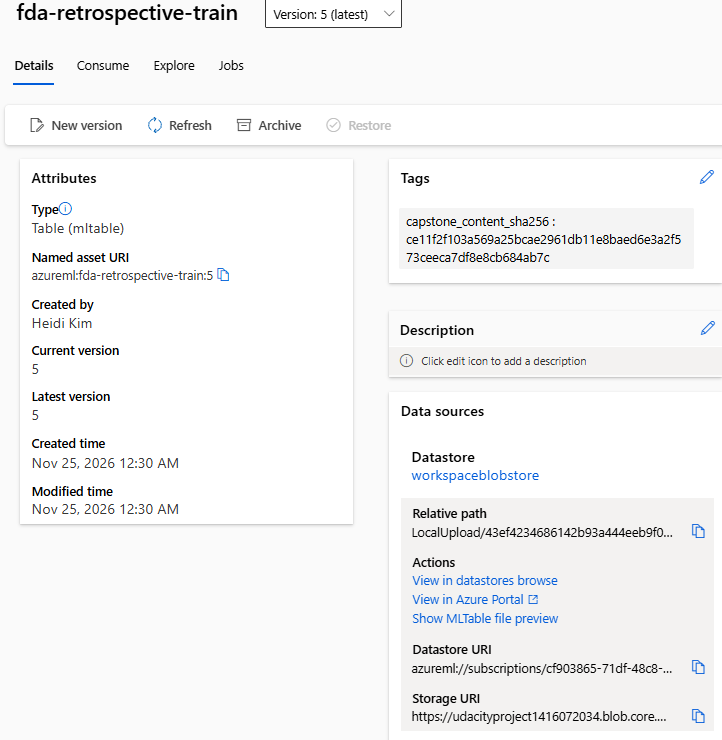
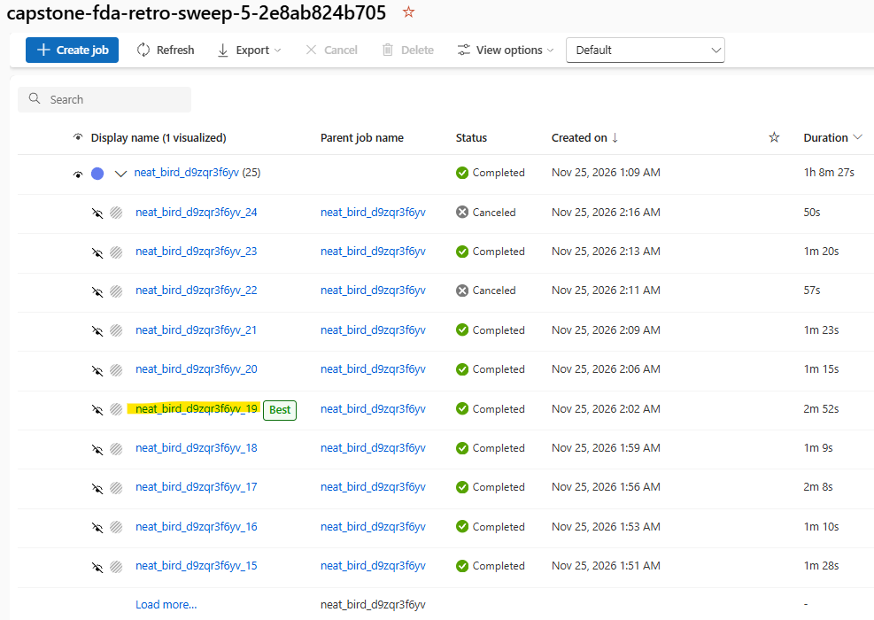
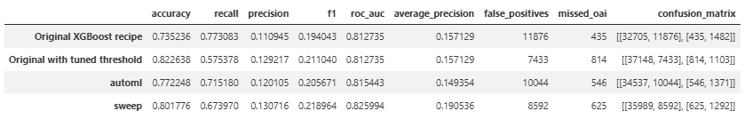
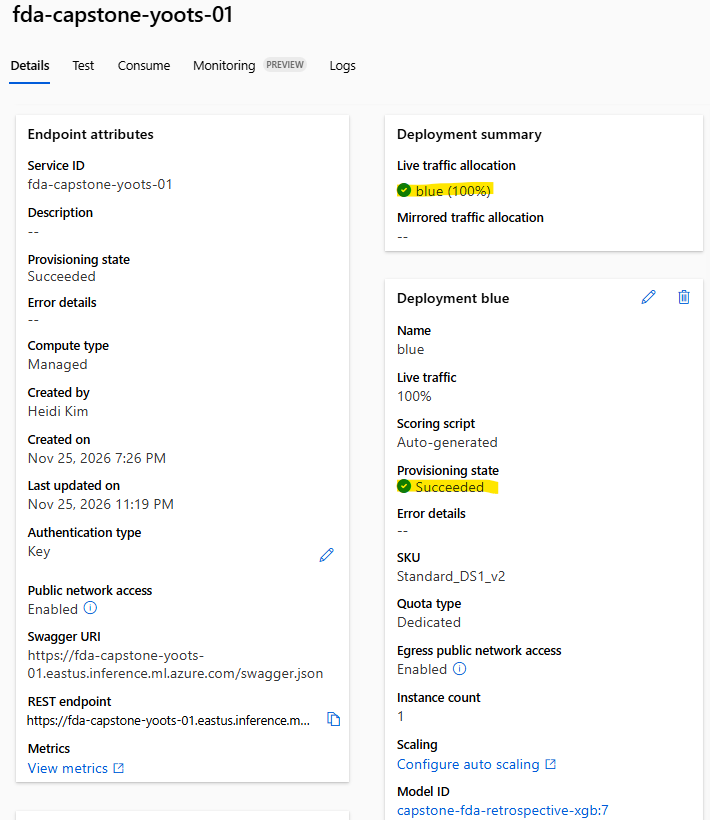
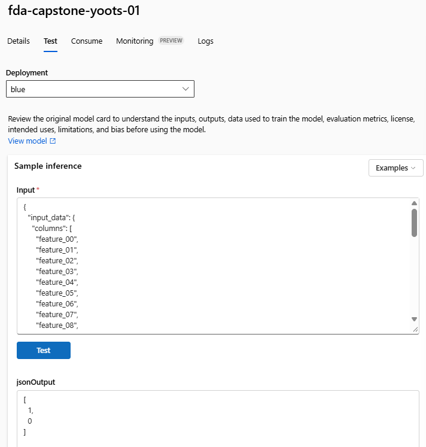

# FDA Inspection Risk Classification with Azure ML SDK v2

This Udacity Capstone classifies recorded FDA inspections for Official Action Indicated (OAI). Azure AutoML and a custom XGBoost sweep train on the same FDA cohort and FEI-disjoint train and validation splits. Both winners are scored on the same holdout. This comparison is **retrospective** because it uses the recorded inspection’s own posted citation count.

## Workflow

```text
FDA workbooks → original 70% cohort → shared FEI splits and compact numeric features
                                              ├─ AutoML → registered winner
                                              └─ smoke → XGBoost sweep → registered winner
Both winners + original benchmark → holdout comparison → accuracy winner → HTTP test
```

`src/prepare_data.py` owns the data and feature recipes. `src/train.py` owns feature-subset ranking, the custom trial, and original benchmark metrics. `pipeline/evaluation.yml` defines the custom command used by the notebook's smoke and sweep. `src/model_registry.py` and `deployment/consume.py` handle lineage and authenticated scoring.

## Azure Run Order

Place both original FDA Excel workbooks in `data/raw/`. Use the same Azure ML SDK v2 notebook kernel. Set `DATA_VERSION` and workspace details in Section 00. On the first run with this recipe, use data version 5 and new version 5 registered model names as configured by default.

| Sections | First run | Reruns |
| --- | --- | --- |
| 00–07 | Enable `PREPARE_DATA` in 03 and `REGISTER_DATA` in 05 once. | Turn both off after the prepared files and registered assets exist. |
| 08–09 | Enable `SUBMIT_AUTO` once. After completion, enable `REGISTER_AUTO_MODEL` once. | Recover the job and registered model with both flags off. |
| 10–13 | Run 10. Submit smoke in 11. Submit sweep in 12 after smoke completes. Register the winner in 13 after completion. | Use the saved job IDs and model version. |
| 14–15 | Score both on the same holdout. The first run also computes and caches historical reference metrics locally. | Review the comparison and recorded deployment choice. |
| 16–21 | Verify the chosen version and inference environment. Create or update the endpoint deployment only as needed, route traffic if needed, and test HTTP scoring. Capture evidence before cleanup. | Keep the action switches off when the expected deployment is already active. |

Turn every action switch back off after it succeeds. Run status or registration cells after their prerequisite jobs complete. AutoML can run while the smoke and sweep branch progresses. Increment the asset and model versions when a new recipe would conflict with existing registered versions. The companion notebooks [automl.ipynb](automl.ipynb) and [hyperparameter_tuning.ipynb](hyperparameter_tuning.ipynb) reuse the master notebook cells. The original starter file contents were unavailable in this checkout.

## Model Settings and Selection

- AutoML evaluates LightGBM and logistic regression with normalized macro recall as its primary metric. It uses the same numeric feature columns and unsampled split assignments as the custom branch.
- The custom sweep uses random sampling and Bandit early termination. It varies tree depth, tree count, learning rate, row and column sampling, SMOTE ratio, and positive-class weight. Each trial chooses its score threshold on validation, logs metrics during training, and saves the fitted model with that threshold.
- Section 14 measures accuracy, OAI recall, precision, F1, ROC AUC, average precision, false positives, and missed OAI cases. Section 15 records the accuracy-based deployment winner required by the task checklist and separately reports whether any candidate exceeded all deck targets.

## Earlier Local Benchmark Results

Local reproduction on the supplied workbook produced 186,547 sampled rows and 46,197 test rows, including 1,950 OAI cases. The original XGBoost recipe chose SMOTE 0.7 and the same ten features shown in the local importance export.

| Local parity model | Accuracy | ROC AUC | OAI precision | OAI recall |
| --- | ---: | ---: | ---: | ---: |
| XGBoost | 0.7415 | 0.8276 | 0.1162 | 0.7754 |
| Random Forest | 0.7445 | 0.8054 | 0.1145 | 0.7508 |
| Logistic Regression | 0.8450 | 0.8228 | 0.1494 | 0.5697 |
| Decision Tree | 0.7454 | 0.7966 | 0.1144 | 0.7462 |

The local Logistic Regression row closely matches the deck's Decision Tree row, and the local Decision Tree row closely matches the deck's Logistic Regression row. The benchmark reports both sets of values under their original labels so the discrepancy is visible.

A local run of the 24-trial search produced the following results on the same 46,498-row holdout with 1,917 OAI cases.

| Model | OAI recall | OAI precision | False positives | ROC AUC |
| --- | ---: | ---: | ---: | ---: |
| Original XGBoost recipe | 78.09% | 11.15% | 11,927 | 0.8120 |
| Original recipe with validation-tuned threshold | 56.08% | 13.01% | 7,186 | 0.8120 |
| Enhanced XGBoost | 83.67% | 11.93% | 11,838 | 0.8596 |

Validation selected the full expanded feature set, a positive class weight of 16, no SMOTE, and a threshold of 0.3754. The enhanced model caught 107 additional OAI cases and generated 89 fewer false positives than the original recipe on this holdout. It exceeded 78% recall and improved on the original recipe's precision. Its holdout precision fell slightly short of the separate 12% deck target. The fixed holdout was not used to change the threshold after scoring.

Both comparisons are retrospective because they include the inspection's own `sum_posted_citations` as in the original model. The separate citation workbook is audited. Its citation-text merge remains excluded, as in the deck implementation. These are prior local results. The new Azure comparison uses a shared compact feature subset for AutoML and XGBoost, so its metrics must be measured again.

## Azure ML Screenshots

Keep the `screenshots/` folder beside this README in Azure ML and in GitHub. The image links below use relative paths. If your captures have different filenames, update the links to match them. Include only screenshots from the runs and model version reported in the final notebook.

### Data and Shared Splits



*Azure ML Data shows the versioned retrospective train, validation, and holdout assets used for the comparison.*

### AutoML Training and Registered Winner


*The AutoML Jobs view shows completed trials and their selection metric.*


*The winning child run and its registered model version correspond to Section 09.*

### XGBoost Sweep and Registered Winner



*The sweep Jobs view shows trial progress and validation metrics.*


*The winning sweep child, tuned parameters, and registered model version correspond to Section 13.*

### Holdout Results and Model Selection



*Sections 14–15 compare both candidates on the same holdout and identify the selected deployment version.*

### Active Deployment and Live Inference



*Azure ML Studio shows the active endpoint, provisioned deployment, and traffic allocation. Include the deployed model version in the capture.*



*Section 20 shows a live scoring response for the sample request used in the demonstration.*

## Screencast

**Hosted screencast:** Add the published video URL here.

<!-- Replace the line above with a Markdown link such as:
**Hosted screencast:** [Watch the FDA Capstone demo](https://www.youtube.com/watch?v=VIDEO_ID)
-->

Record a 1–5 minute demo at 1080p or higher in 16:9. Show the versioned dataset, both training branches, the holdout comparison, the active deployment, and a live request and response. Verify the hosted link opens with viewer permissions before submitting.

## Submission and GitHub

Include the inference environment details, sample request, source scripts, both companion notebooks, master notebook, and the `screenshots/` tree in the submission ZIP. Leave out trained model binaries and the video file. Use [Publish-Capstone.txt](Publish-Capstone.txt) with a clean GitHub clone under `yoots88`. Pass the reviewed screenshot paths through `-Evidence` and use the preview to confirm they are included before publishing.

## Future Improvements

Measure prospective performance with inputs available before an inspection and evaluate on a fresh temporal holdout. Calibrate thresholds using review capacity and the cost of missed OAI cases.
